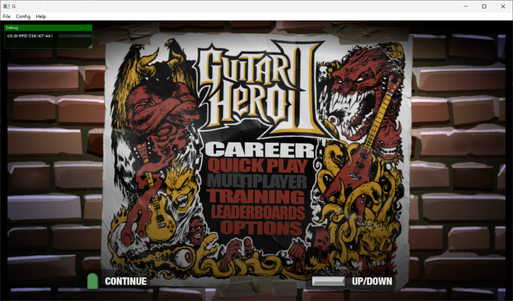
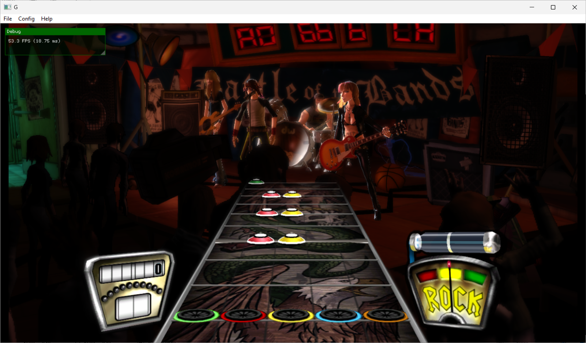
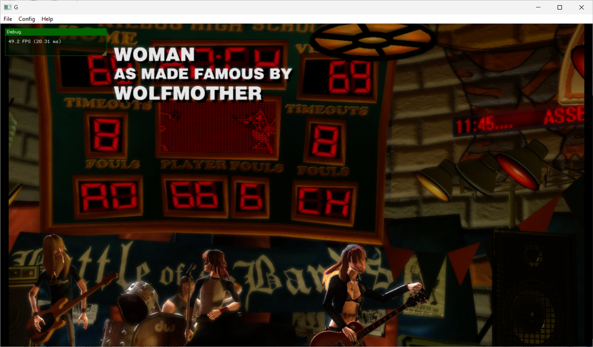

# Guitar Hero II Recompiled

**A native Windows 11 static recompilation of Guitar Hero II for Xbox 360.**

```
    ____       _ __              __  __                ________
   / __ \___  / / /___ ___     / / / /__  _________  / / ____/
  / /_/ / _ \/ / / __ `__ \   / /_/ / _ \/ ___/ __ \/ / __/
 / _, _/  __/ / / / / / / /  / __  /  __/ /  / /_/ /_/ /___
/_/ |_|\___/_/_/_/ /_/ /_/  /_/ /_/\___/_/   \____(_)_____/
```

## The Legend

November 7, 2006. The day everything changed.

Guitar Hero II dropped on Xbox 360 and turned living rooms into sold-out arenas
overnight. Suddenly your buddy who couldn't play an actual chord was *shredding*
"Free Bird" at 3 AM while your neighbors called the cops. The plastic guitar
wasn't just a controller -- it was a lifestyle.

Harmonix built something magical. 70+ tracks spanning decades of rock history.
"Sweet Child O' Mine." "Killing in the Name." "YYZ." "Jessica." Every song
felt like you were actually *there*, fingers flying across five colored frets
while the crowd roared and the stage lights blazed.

The Xbox 360 version was the definitive edition -- the first time Guitar Hero
went HD, the first time it hit Xbox Live with leaderboards, and the version
that introduced practice mode so you could finally nail that Hangar 18 solo
one section at a time.

GH2 wasn't just a game. It was a cultural phenomenon. It sold over 5 million
copies, introduced an entire generation to bands they'd never heard of, and
kickstarted a billion-dollar rhythm game industry. Your parents bought Wiis.
You bought a Les Paul controller.

**Now it's back. Running natively on Windows 11. No emulator. No compromises.**

<p align="center">
  
</p>
<p align="center">
  
  
</p>

## What Is This?

This is a **static recompilation** of Guitar Hero II's Xbox 360 executable.
Instead of emulating the PowerPC CPU instruction-by-instruction at runtime
(like Xenia does), we translate the entire game binary ahead of time into
native x86-64 C++ code. The result is a native Windows executable that runs
at full speed with proper D3D12 graphics.

The pipeline:

```
Xbox 360 XEX Binary
        |
        v
  [XenonRecomp]     -- PowerPC disassembly + static analysis
        |
        v
  [ReXGlue SDK]     -- Code generation (PPC -> C++)
        |
        v
  Native C++ Code   -- Compiled with Clang for x86-64
        |
        v
  gh2.exe            -- Native Windows 11 executable
```

Built on the shoulders of giants:
- **[ReXGlue SDK](https://github.com/rexglue/rexglue-sdk)** by hedge-dev -- The Xbox 360 static recompilation framework
- **[XenonRecomp](https://github.com/hedge-dev/XenonRecomp)** -- PowerPC to C++ static recompiler
- **[re-gh2](https://github.com/YoshiCrystal9/re-gh2)** by YoshiCrystal9 -- Original proof-of-concept that got GH2 booting
- **[360tools](https://github.com/sp00nznet/360tools)** -- Xbox 360 extraction and analysis toolkit

## Current Status

| Component | Status |
|-----------|--------|
| XEX Extraction | Done |
| PE Analysis | Done (8.9MB PE, 16 sections) |
| Function Discovery | 34,942 functions analyzed |
| ReXGlue Codegen | Done (34,763 functions recompiled) |
| Boot to Menu | Working |
| Gameplay | Working |
| Audio | Working |
| Keyboard Input | Working |
| ARKless File Loading | Working |
| Settings/Menu UI | Working |
| Unlock All Songs | Working (debug setting) |
| Guitar Controller | Not yet tested |

## Project Structure

```
gh2/
  config/                  # XenonRecomp + ReXGlue TOML configs
  docs/                    # Build guides, binary analysis notes
  generated/               # Auto-generated C++ from codegen (gitignored)
  ppc/                     # PPC config headers for generated code
  project/                 # CMake build system
    src/                   # Hand-written C++ source
      main.cpp             # Application entry point, runtime setup
      stubs.cpp            # Xbox 360 kernel/XAM stub overrides
      arkless.cpp          # Loose file loading (bypass ARK archives)
      settings.cpp/.h      # TOML-based user settings persistence
      menu.cpp/.h          # Win32 menu bar + ImGui config dialogs
      keyboard_driver.cpp/.h  # Keyboard-to-guitar input mapping
      unlocks.cpp/.h       # Debug song unlock (bypass career progression)
      test_boot.cpp        # Console-mode crash isolation harness
  tools/                   # Extraction & analysis scripts
    patches/               # XenonRecomp instruction patches
  scripts/                 # Game-specific automation
  assets/                  # Extracted game files (gitignored)
  images/                  # Screenshots
```

## Building

### Prerequisites

- **Windows 11** (x86-64)
- **CMake** 3.25+
- **Clang** 18+ (MSVC is NOT supported for compilation)
- **Ninja** build system
- **ReXGlue SDK** v0.2.1+ ([releases](https://github.com/rexglue/rexglue-sdk/releases))
- **XenonRecomp** (with patches from `tools/patches/`)
- **Guitar Hero II Xbox 360 disc image** (you must provide your own legally-obtained copy)

### Setup

```bash
# 1. Clone the repo
git clone https://github.com/sp00nznet/gh2.git
cd gh2

# 2. Set REXSDK to your ReXGlue SDK installation
export REXSDK=/path/to/rexglue-sdk/install

# 3. Extract your Guitar Hero II ISO into assets/
#    (must contain default.xex and game data files)

# 4. Run codegen to translate PPC -> C++
cd project
cmake --preset win-amd64
cmake --build out/build/win-amd64 --target gh2_codegen --config Release

# 5. Build the native executable
cmake --build out/build/win-amd64 --target gh2 --config Release

# 6. Run it
./out/build/win-amd64/Release/gh2.exe ../assets
```

### Using the Analysis Tools

```bash
# Extract PE from XEX
python tools/extract_pe.py assets/default.xex assets/default.pe

# Find ABI helper addresses
python tools/find_abi_addrs.py assets/default.pe

# Parse XEX imports (kernel/XAM stubs needed)
python tools/parse_xex_imports.py assets/default.xex

# Extract switch tables
python tools/extract_switch_tables.py assets/default.pe

# Find vtable functions missed by static analysis
python tools/find_missing_vtable_funcs.py assets/default.pe
```

## Controls

### Keyboard (Default)

| Key | Action |
|-----|--------|
| W / Up | Strum Up |
| S / Down | Strum Down |
| A / Left | Navigate Left |
| D / Right | Navigate Right |
| Z / J | Green Fret |
| X / K | Red Fret |
| C / L | Yellow Fret |
| V | Blue Fret |
| B | Orange Fret |
| Enter | Start / Pause |
| Backspace / Esc | Back |
| Q / E | Star Power / Whammy |
| F11 | Toggle Fullscreen |

### Xbox Controller

Native Xbox controller support via SDL2. Guitar controllers should work
as standard gamepads. Controller assignment available in Config > Controllers.

## Acknowledgments

This project wouldn't exist without:

- **Harmonix** -- For creating one of the greatest games ever made
- **RedOctane** -- For the plastic guitar that changed everything
- **YoshiCrystal9** -- For the initial re-gh2 proof of concept
- **ihatecompvir** -- For the ARKless file loading contribution
- **hedge-dev** -- For ReXGlue SDK and XenonRecomp
- **The Xenia team** -- For years of Xbox 360 emulation research
- Everyone who ever five-starred "Through the Fire and Flames" on Expert

## Legal

This project does not include any copyrighted game assets. You must provide
your own legally-obtained copy of Guitar Hero II for Xbox 360. This is a
clean-room reimplementation of the runtime environment, not a distribution
of the game itself.

---

*"I wanna rock!"* -- Twisted Sister, and also you, probably, right now
